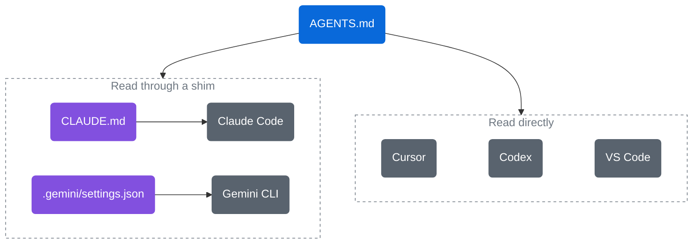

# Over AI Engineering

Engineers using multiple coding agents cannot tell the minimum repository configuration required for productive development from the optional layers that vendors keep shipping.

This repo is the end-to-end answer: a mandatory vs optional checklist, copy-paste templates, and an acceptance test. It is not a ranking of models or products.

## Problem

**Under-configured.** The agent guesses install, test, and safety. The same task gets a different toolchain in each tool. Dangerous commands are only blocked if someone happens to be watching.

**Over-configured.** Unnecessary always-on instructions and exposed tool schemas crowd the context. Rules contradict each other across `AGENTS.md`, `CLAUDE.md`, `.cursorrules`, and Copilot instructions. One published example counted [about 55K tokens of schemas across five MCP servers](https://www.anthropic.com/research/advanced-tool-use), before any task work. Stale instruction files are followed even when they disagree with the code, because the file is loaded as an instruction and the code arrives as tool output ([Xu and Wu, 2026](https://arxiv.org/abs/2610.30571)).

**Outcome.** One small always-on config, plus optional layers that exist only because a repeated task, a path-specific rule, or a live system required them.

## How it works

`AGENTS.md` holds the commands, refusals, and review rules. Cursor, Codex, and VS Code read it directly. Claude Code reads `AGENTS.md` directly when no `CLAUDE.md` is present, and through `CLAUDE.md` when one is. Gemini CLI reads it when `context.fileName` includes `AGENTS.md`.

Blue is the source of truth. Purple is a shim. Gray is an agent.

The `.gemini/settings.json` box is the optional project shim from [templates/gemini-settings.json](templates/gemini-settings.json), copied in only when Gemini CLI is in use, so this repo does not commit it.

## How to use this repo

Audit the product repo, add the mandatory files, and run the acceptance test on every agent in use. Fix and re-test until it passes, then stop. Add an optional layer only when its trigger fires, and test again. The checklist's [apply order](docs/repo-config-checklist.md#apply-order) is this flow. Record each real run in [docs/acceptance-results.md](docs/acceptance-results.md). That table is empty until a run fills it.

Blue is the mandatory set. Amber is the check, red is rework, and green is done. The dashed line runs only after a trigger fires, and that layer is tested again.

## Published skill benchmarks

This repository did not run these studies. The numbers below come from the papers, checked on 2026-11-26. Each paper compares runs with and without skills. Their scores measure different things.

[SkillsBench](https://arxiv.org/abs/2602.12670) evaluates 87 tasks across 18 model and harness setups. Curated skills raise the average task pass rate from **33.9% to 50.5%**, a gain of 16.6 percentage points. The gain by setup runs from 4.1 to 25.7 points. Thirteen tasks get worse.

[SWE-Skills-Bench](https://arxiv.org/abs/2603.15401) evaluates 98 public software skills, each on ten repository requirements under four setups. The average share of executable checks passed moves from **76.59% to 76.93%**. Each requirement contributes equally to that average. Ninety-two skills have no statistically detectable effect under the paper's test; four help and two hurt. No detected effect does not mean a proved zero effect.

The samples and loading routes differ too. SkillsBench filters out tasks with no measurable separation between conditions and leaves skill discovery to the agent. SWE-Skills-Bench derives requirements from each skill and invokes it explicitly. The difference between their averages does not isolate the effect of curation or task difficulty.

SkillsBench also groups results by skill count and document length. Smaller bundles and shorter documents show larger average gains, but those groups contain different tasks. The comprehensive-documentation group has only five tasks. These comparisons are a reason to test a shorter procedure, not proof that cutting lines will improve one.

The [Agent Skills specification](https://agentskills.io/specification) describes the loading order: `name` and `description` first, the body when activated, then resources as needed. A valid file, a skill that loads, and a skill that helps are separate checks.

To measure one skill, use [docs/skill-quality.md](docs/skill-quality.md) and record real evidence in [templates/skill-quality-check.md](templates/skill-quality-check.md). Use repeated paired runs with the same tasks, checks, agent, and starting state. Keep required checks, including ones both runs pass. Keep the skill when the declared quality or efficiency benefit repeats, required behavior does not regress, and the tokens and time fit the cost you accepted. A file that contains one task's answer cannot establish reusable value.

The measurement record stays empty until those runs exist. This repo's separate configuration acceptance record is [docs/acceptance-results.md](docs/acceptance-results.md); published benchmark averages fill neither record.

## What's in this repo

| Path | Use it to |
| --- | --- |
| [docs/repo-config-checklist.md](docs/repo-config-checklist.md) | Audit, mandatory set, acceptance test, optional layers |
| [templates/AGENTS.md](templates/AGENTS.md) | Start the always-on rules |
| [templates/CLAUDE.md](templates/CLAUDE.md) | Point Claude Code at `AGENTS.md` |
| [templates/gemini-settings.json](templates/gemini-settings.json) | Point Gemini CLI at `AGENTS.md` |
| [templates/gitignore](templates/gitignore) | Keep personal agent files and secrets out of git |
| [templates/acceptance-test.md](templates/acceptance-test.md) | Run the acceptance test and record the result per agent |
| [docs/acceptance-results.md](docs/acceptance-results.md) | Record those runs. The table is empty until a real run fills it |
| [templates/skill/SKILL.md](templates/skill/SKILL.md) | Start a skill, once its trigger fires |
| [docs/skill-quality.md](docs/skill-quality.md) | Measure a skill before you keep it |
| [templates/skill-quality-check.md](templates/skill-quality-check.md) | Record that measurement. The table is empty until a real run fills it |

This repo follows its own checklist: the root [AGENTS.md](AGENTS.md), [CLAUDE.md](CLAUDE.md), and [.gitignore](.gitignore) are the mandatory set for a docs-only repo. To change the repo, follow [AGENTS.md](AGENTS.md).

## License

[CC0 1.0](LICENSE). Copy the templates into any repo with no notice or attribution.

## Support

