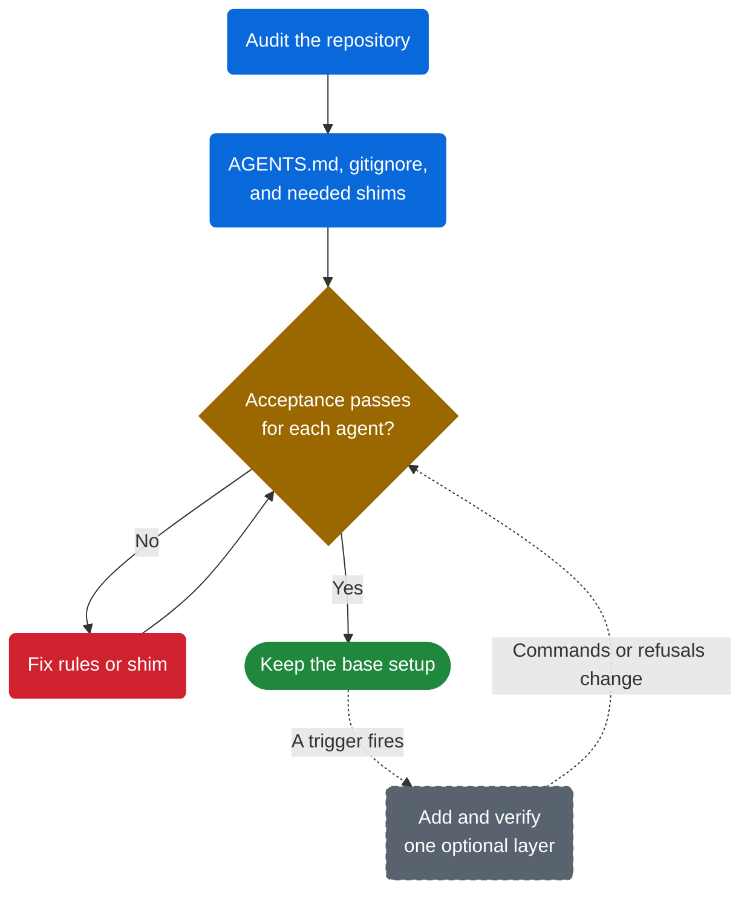
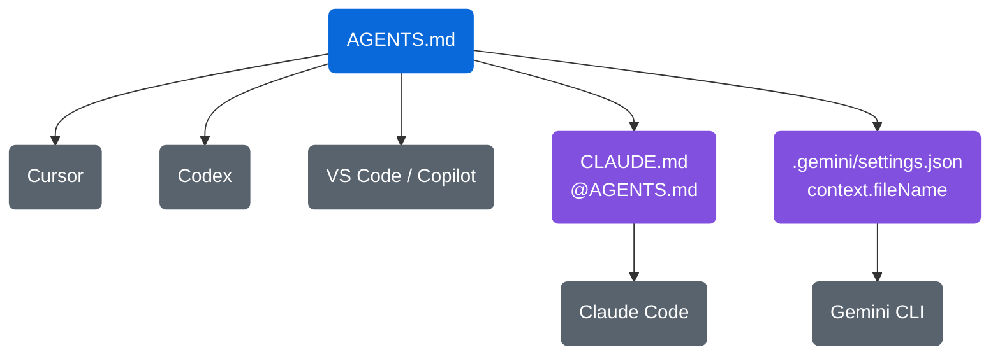
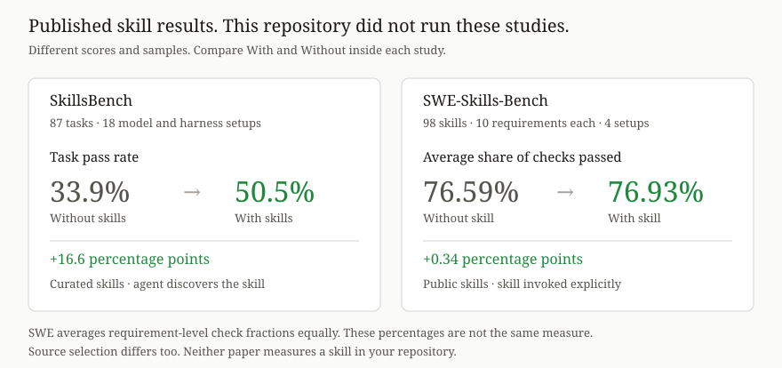

# Over AI Engineering

A checklist and copyable templates for giving coding agents your repository's commands, boundaries, and review rules.

Start with one `AGENTS.md`, gitignore entries, and the shims your agents need. Add skills, MCP, or path-specific rules when a concrete task justifies them. Keep the configuration small enough to review and verify.

This is a documentation project. There is no package to install or application to run. Copy the relevant templates into your product repository and replace the placeholders with its actual commands and rules.

## Quick start

1. **Audit the repository.** Use the [audit table](docs/repo-config-checklist.md#audit-first) to find missing commands, conflicting instructions, and optional layers without a clear use.
2. **Set the shared rules.** Fill in [the `AGENTS.md` template](templates/AGENTS.md) and merge [the gitignore entries](templates/gitignore) into the existing `.gitignore`.
3. **Add the shims you need.** Follow the [agent-specific instructions](docs/repo-config-checklist.md#3-thin-shims). Use [the Claude import](templates/CLAUDE.md) when Claude Code is in use. For Gemini CLI, merge [the context setting](templates/gemini-settings.json) into its project settings; preserve existing settings.
4. **Check the setup on a real task.** Run [the acceptance test](templates/acceptance-test.md) in a fresh session for each agent in use. Record the commands, results, and evidence. Fix the shared rules or shim when a check fails.
5. **Stop when the base setup works.** Use [the optional-layer triggers](docs/repo-config-checklist.md#optional) before adding anything else. Verify each added layer, and rerun acceptance when commands or refusals change.

The [full checklist](docs/repo-config-checklist.md) contains the paths, conditions, and apply order.

## One set of rules, thin shims

Keep project commands, refusals, and review rules in `AGENTS.md`. A shim points an agent at those rules; it does not maintain another copy.

Cursor, Codex, and VS Code/Copilot support `AGENTS.md` directly. Claude Code's direct loading depends on its version and nearby Claude instruction files; this checklist uses a one-line `CLAUDE.md` import for consistency. Gemini CLI needs `AGENTS.md` included in `context.fileName`. The [vendor notes](docs/repo-config-checklist.md#3-thin-shims) explain the conditions and exceptions.

The diagram shows the recommended setup for the agents you use. The Gemini settings file is a template to merge into a product repository, not a required file in this repository.

## Add a layer for a reason

The [trigger table](docs/repo-config-checklist.md#optional) is the decision point. A repeated procedure may justify a skill. A rule limited to certain files may justify path-scoped instructions. A live-system task may justify MCP when a documented command does not cover it.

Adding a file is not evidence that the layer helps. Verify its intended behavior and remove it when its trigger stops being true. Instructions describe boundaries; they do not replace tool permissions or other enforcement.

## Measure a skill before keeping it

The [Agent Skills specification](https://agentskills.io/specification) describes the file format and progressive loading: metadata first, the body when activated, then resources as needed. A valid file, a skill that loads, and a skill that helps are separate checks:

1. **Read the file.** Check required format, executable steps, and scope boundaries. Treat size guidance as a recommendation, not a validity rule.
2. **Test discovery.** Use intended tasks and near misses that do not name the skill. Keep fresh test prompts separate from those used to edit or select a description.
3. **Compare paired runs.** Freeze success checks, repeat with and without the skill from the same starting state, and retain gains and regressions. Record activation, time, tokens, and evidence.

Keep the skill for the tested use when the declared benefit repeats, required behavior does not regress, and the cost is acceptable. Equal required quality with less time or fewer tokens can qualify. Missing runs stay unmeasured; mixed evidence stays inconclusive.

Use [the measurement guide](docs/skill-quality.md) and [the blank record](templates/skill-quality-check.md) for the procedure and individual results. Explicit invocation can test execution, but it bypasses discovery. No individual skill result is recorded in this repository.

## Published skill benchmarks

These are published results, not experiments run by this repository. The two panels use different measures. Sources checked on 26 November 2026.

- [SkillsBench](https://arxiv.org/html/2602.12670v4): 87 tasks across 18 model-harness setups. Average task pass rate rises from **33.9% to 50.5%**, a gain of 16.6 percentage points. Thirteen tasks get worse.
- [SWE-Skills-Bench](https://arxiv.org/html/2603.15401v2): 98 public skills, ten repository-specific requirements per skill, and four setups. The average share of executable checks passed moves from **76.59% to 76.93%**. Ninety-two skills have no statistically detectable effect.

Task selection and invocation differ between the studies, so their averages do not isolate why one skill helps. Use the [measurement guide](docs/skill-quality.md) to test a skill in its intended setup; a published average cannot fill its result record.

## Files to use

| File | Purpose |
| --- | --- |
| [Repository checklist](docs/repo-config-checklist.md) | Audit, mandatory configuration, vendor paths, and optional-layer triggers |
| [`AGENTS.md` template](templates/AGENTS.md) | Shared project commands, refusals, and review rules |
| [Gitignore entries](templates/gitignore) | Exclude secrets and personal agent files |
| [Claude import](templates/CLAUDE.md) / [Gemini context setting](templates/gemini-settings.json) | Point supported agents at the shared rules |
| [Acceptance test](templates/acceptance-test.md) | Verify the base configuration in fresh agent sessions |
| [Repository acceptance record](docs/acceptance-results.md) | Record this repository's actual acceptance runs; currently empty |
| [Skill starter](templates/skill/SKILL.md) | Start a repeated procedure after its trigger fires |
| [Skill measurement guide](docs/skill-quality.md) / [blank record](templates/skill-quality-check.md) | Test file quality, discovery, output, and cost |

## Contributing

Follow [AGENTS.md](AGENTS.md). This documentation project has no automated suite. Check changes against the checklist, templates, diagrams, and relative links, then leave a branch and pull request for review.

The repository's [acceptance record](docs/acceptance-results.md) is empty. Having the configuration files in place does not establish that every agent has passed the acceptance test.

## License and support

[CC0 1.0](LICENSE). Copy and adapt the templates for your repository.

Support the project on [Buy Me a Coffee](https://buymeacoffee.com/santoshshin).
