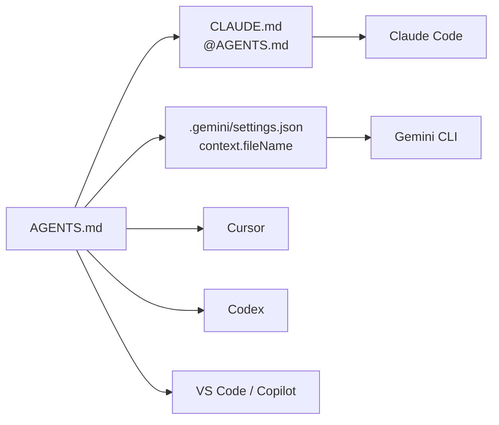
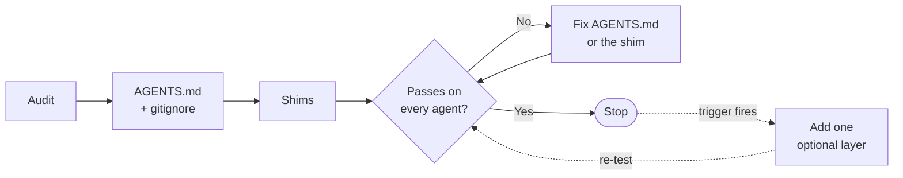

# Over AI Engineering

Engineers using multiple coding agents cannot tell the minimum repository configuration required for productive development from the optional layers that vendors keep shipping.

This repo is the end-to-end answer: a problem statement, a mandatory vs optional checklist, copy-paste templates, and an acceptance test. It is not a ranking of models or products.

## Problem statement

**Problem.** A product repo does not tell Cursor, Claude Code, VS Code/Copilot, and other agents how to do the work. Each tool can read rules, skills, and MCP, but each one looks in different files.

**Who.** An engineer or team shipping a real product, already using one or more of those agents on the same codebase.

**Assumption.** The agent is already chosen. The repo is the shared control point. Model names change in months; the files in the repo are what every agent can keep reading.

**Job.** For data, software, application, and UI/UX work, a fresh session on any agent the team uses takes a scoped change through one loop: read the rules and refusals, edit the right files, run the project's own checks, stop when a refusal applies, and leave a diff a human can review.

**What makes it hard.** The major agents share three standards — `AGENTS.md`, Agent Skills (`SKILL.md`), and MCP — but read them from different folders, with different approval models and no shared MCP file. Claude Code and Gemini CLI skip `AGENTS.md` unless a shim points them to it.

**Failure modes.**

- **Under-configured.** The agent guesses install, test, and safety. The same task gets a different toolchain in each tool. Dangerous commands are only blocked if someone happens to be watching.
- **Over-configured.** Every skill and MCP server is loaded on every turn. Rules contradict each other across `AGENTS.md`, `CLAUDE.md`, `.cursorrules`, and Copilot instructions. Tool schemas can cost tens of thousands of tokens before the agent reads the code. Stale instructions are followed because the agent trusts them.

**Outcome.** One small always-on config, plus optional layers that exist only because a repeated task, a path-specific rule, or a live system required them.

**Done when all of these are true.**

- The mandatory files are present, accurate, and small enough to review in one sitting.
- Personal agent files and secrets are gitignored.
- A real task passes the [acceptance test](docs/repo-config-checklist.md#acceptance-test) on every agent in use, recorded in a copy of [templates/acceptance-test.md](templates/acceptance-test.md).
- Every optional layer (skill, MCP server, path rule, hook) has a trigger. Layers without a trigger are removed.

## How it works

`AGENTS.md` holds the commands, refusals, and review rules. Cursor, Codex, and VS Code read it directly. Claude Code and Gemini CLI read it through a one-line shim.

## How to use this repo

Audit the product repo, add the mandatory files, and run the acceptance test on every agent in use. Fix and re-test until it passes, then stop. Add an optional layer only when its trigger fires, and test again. The checklist's [apply order](docs/repo-config-checklist.md#apply-order) has each step.

## What's in this repo

| Path | Use it to |
| --- | --- |
| [docs/repo-config-checklist.md](docs/repo-config-checklist.md) | Audit, mandatory set, acceptance test, optional layers |
| [templates/AGENTS.md](templates/AGENTS.md) | Start the always-on rules |
| [templates/CLAUDE.md](templates/CLAUDE.md) | Point Claude Code at `AGENTS.md` |
| [templates/gitignore](templates/gitignore) | Keep personal agent files and secrets out of git |
| [templates/acceptance-test.md](templates/acceptance-test.md) | Run the acceptance test and record the result per agent |
| [templates/skill/SKILL.md](templates/skill/SKILL.md) | Start a skill, once its trigger fires |

This repo follows its own checklist: the root [AGENTS.md](AGENTS.md), [CLAUDE.md](CLAUDE.md), and [.gitignore](.gitignore) are the mandatory set for a docs-only repo. To change the repo, follow [AGENTS.md](AGENTS.md).

## License

[CC0 1.0](LICENSE). Copy the templates into any repo with no notice or attribution.
