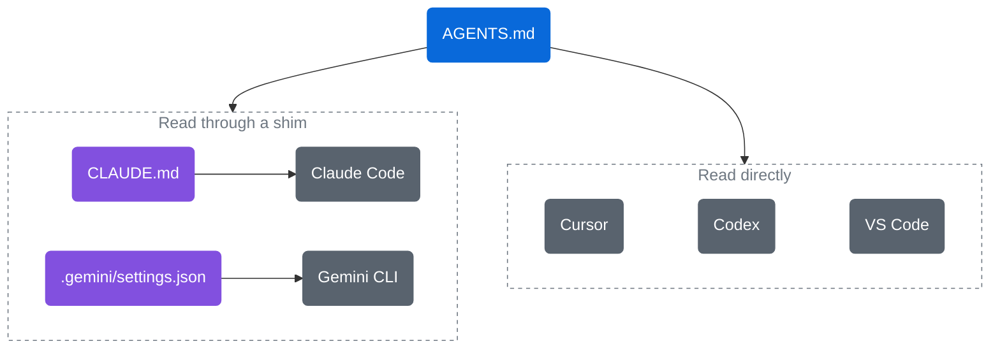
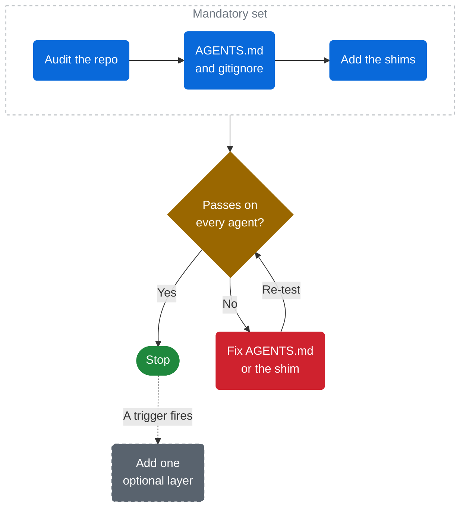

# Over AI Engineering

Engineers using multiple coding agents cannot tell the minimum repository configuration required for productive development from the optional layers that vendors keep shipping.

This repo is the end-to-end answer: a mandatory vs optional checklist, copy-paste templates, and an acceptance test. It is not a ranking of models or products.

## Problem

**Under-configured.** The agent guesses install, test, and safety. The same task gets a different toolchain in each tool. Dangerous commands are only blocked if someone happens to be watching.

**Over-configured.** Every skill and MCP server is loaded on every turn. Rules contradict each other across `AGENTS.md`, `CLAUDE.md`, `.cursorrules`, and Copilot instructions. Tool schemas can cost tens of thousands of tokens before the agent reads the code ([about 55K tokens across five MCP servers](https://www.anthropic.com/research/advanced-tool-use)). Stale instruction files are followed even when they disagree with the code, because the file is loaded as an instruction and the code arrives as tool output ([Xu and Wu, 2026](https://arxiv.org/abs/2610.30571)).

**Outcome.** One small always-on config, plus optional layers that exist only because a repeated task, a path-specific rule, or a live system required them.

## How it works

`AGENTS.md` holds the commands, refusals, and review rules. Cursor, Codex, and VS Code read it directly. Claude Code reads `AGENTS.md` directly when no `CLAUDE.md` is present, and through `CLAUDE.md` when one is. Gemini CLI reads it when `context.fileName` includes `AGENTS.md`.

Blue is the source of truth. Purple is a shim. Gray is an agent.

The `.gemini/settings.json` box is the optional project shim from [templates/gemini-settings.json](templates/gemini-settings.json), copied in only when Gemini CLI is in use, so this repo does not commit it.

## How to use this repo

Audit the product repo, add the mandatory files, and run the acceptance test on every agent in use. Fix and re-test until it passes, then stop. Add an optional layer only when its trigger fires, and test again. The checklist's [apply order](docs/repo-config-checklist.md#apply-order) is this flow. Record each real run in [docs/acceptance-results.md](docs/acceptance-results.md). That table is empty until a run fills it.

Blue is the mandatory set. Amber is the check, red is rework, and green is done. The dashed line runs only after a trigger fires, and that layer is tested again.

## Published skill benchmarks

This repository did not run these studies. The chart copies their published pass rates, checked on 2026-11-26. A skill in a product repo is judged the same way: the same task, once with the skill and once without it.

| Study | Without a skill | With a skill | What the paper reports |
| --- | --- | --- | --- |
| [SkillsBench](https://arxiv.org/abs/2602.12670), 87 hard tasks, 18 setups | 33.9% | 50.5% | Average lift of 16.6 points. By setup the lift runs from 4.1 to 25.7 points. 13 of 87 tasks got worse. |
| [SWE-Skills-Bench](https://arxiv.org/abs/2603.15401), 98 public software skills | 76.59% | 76.93% | 92 of 98 skills had no detectable effect. Four helped. Two hurt. |

SkillsBench also reports that more skills are not a larger lift: one skill gained 18.0 points, two or three gained 19.0, and four or more gained 10.1. Compact and standard-length skills gained about 19 to 21.5 points. Comprehensive documentation gained 0.7.

The third reference for how a skill is loaded, not for these pass rates, is the [Agent Skills specification](https://agentskills.io/specification). The agent sees `name` and `description` before it opens the file.

This repo's own acceptance table stays empty until a real run fills [docs/acceptance-results.md](docs/acceptance-results.md).

## What's in this repo

| Path | Use it to |
| --- | --- |
| [docs/repo-config-checklist.md](docs/repo-config-checklist.md) | Audit, mandatory set, acceptance test, optional layers |
| [templates/AGENTS.md](templates/AGENTS.md) | Start the always-on rules |
| [templates/CLAUDE.md](templates/CLAUDE.md) | Point Claude Code at `AGENTS.md` |
| [templates/gemini-settings.json](templates/gemini-settings.json) | Point Gemini CLI at `AGENTS.md` |
| [templates/gitignore](templates/gitignore) | Keep personal agent files and secrets out of git |
| [templates/acceptance-test.md](templates/acceptance-test.md) | Run the acceptance test and record the result per agent |
| [docs/acceptance-results.md](docs/acceptance-results.md) | Record those runs. The table is empty until a real run fills it |
| [templates/skill/SKILL.md](templates/skill/SKILL.md) | Start a skill, once its trigger fires |
| [docs/skill-quality.md](docs/skill-quality.md) | Measure a skill before you keep it |
| [templates/skill-quality-check.md](templates/skill-quality-check.md) | Record that measurement. The table is empty until a real run fills it |

This repo follows its own checklist: the root [AGENTS.md](AGENTS.md), [CLAUDE.md](CLAUDE.md), and [.gitignore](.gitignore) are the mandatory set for a docs-only repo. To change the repo, follow [AGENTS.md](AGENTS.md).

## License

[CC0 1.0](LICENSE). Copy the templates into any repo with no notice or attribution.

## Support

