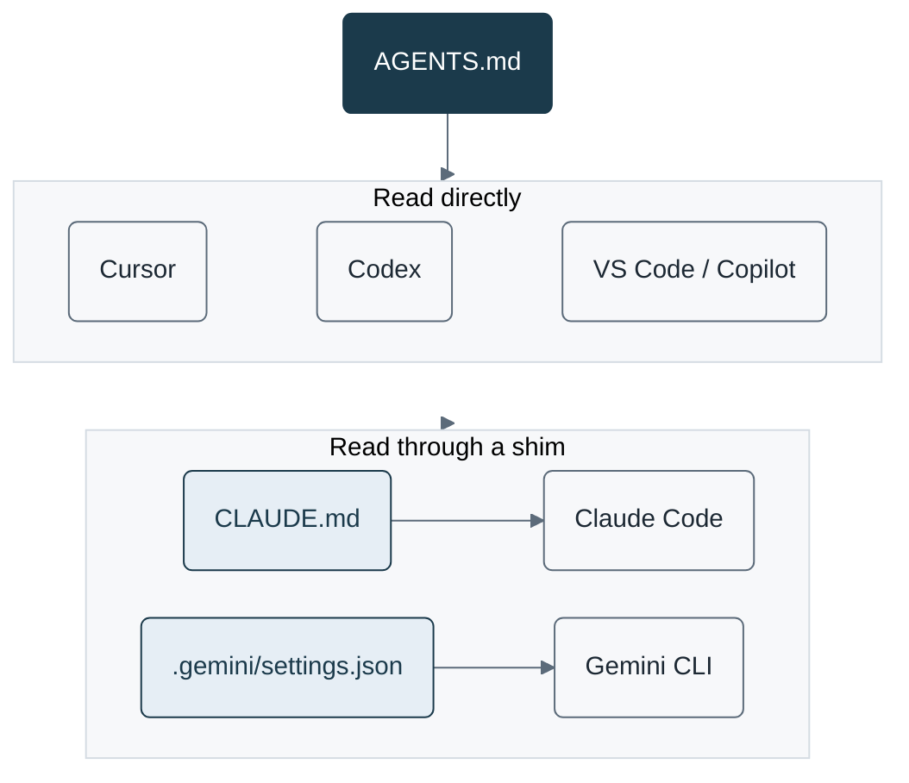
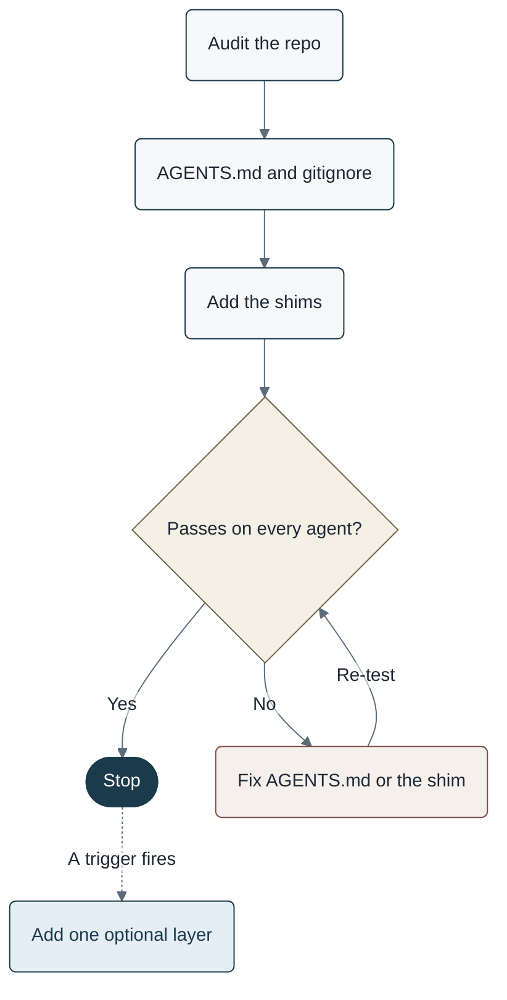

# Over AI Engineering

Engineers using multiple coding agents cannot tell the minimum repository configuration required for productive development from the optional layers that vendors keep shipping.

This repo is the end-to-end answer: a mandatory vs optional checklist, copy-paste templates, and an acceptance test. It is not a ranking of models or products.

## Problem

**Under-configured.** The agent guesses install, test, and safety. The same task gets a different toolchain in each tool. Dangerous commands are only blocked if someone happens to be watching.

**Over-configured.** Every skill and MCP server is loaded on every turn. Rules contradict each other across `AGENTS.md`, `CLAUDE.md`, `.cursorrules`, and Copilot instructions. Tool schemas can cost tens of thousands of tokens before the agent reads the code. Stale instructions are followed because the agent trusts them.

**Outcome.** One small always-on config, plus optional layers that exist only because a repeated task, a path-specific rule, or a live system required them.

## How it works

`AGENTS.md` holds the commands, refusals, and review rules. Cursor, Codex, and VS Code read it directly. Claude Code reads it through `CLAUDE.md`. Gemini CLI reads it when `context.fileName` includes `AGENTS.md`.

Navy is the source of truth. Blue is a shim. Gray is an agent.

## How to use this repo

Audit the product repo, add the mandatory files, and run the acceptance test on every agent in use. Fix and re-test until it passes, then stop. Add an optional layer only when its trigger fires, and test again. The checklist's [apply order](docs/repo-config-checklist.md#apply-order) is this flow.

Solid lines are the required path. Stone is the decision. Clay is rework. The dashed line runs only after a trigger fires, and that layer is tested again.

## What's in this repo

| Path | Use it to |
| --- | --- |
| [docs/repo-config-checklist.md](docs/repo-config-checklist.md) | Audit, mandatory set, acceptance test, optional layers |
| [templates/AGENTS.md](templates/AGENTS.md) | Start the always-on rules |
| [templates/CLAUDE.md](templates/CLAUDE.md) | Point Claude Code at `AGENTS.md` |
| [templates/gemini-settings.json](templates/gemini-settings.json) | Point Gemini CLI at `AGENTS.md` |
| [templates/gitignore](templates/gitignore) | Keep personal agent files and secrets out of git |
| [templates/acceptance-test.md](templates/acceptance-test.md) | Run the acceptance test and record the result per agent |
| [templates/skill/SKILL.md](templates/skill/SKILL.md) | Start a skill, once its trigger fires |

This repo follows its own checklist: the root [AGENTS.md](AGENTS.md), [CLAUDE.md](CLAUDE.md), and [.gitignore](.gitignore) are the mandatory set for a docs-only repo. To change the repo, follow [AGENTS.md](AGENTS.md).

## License

[CC0 1.0](LICENSE). Copy the templates into any repo with no notice or attribution.
