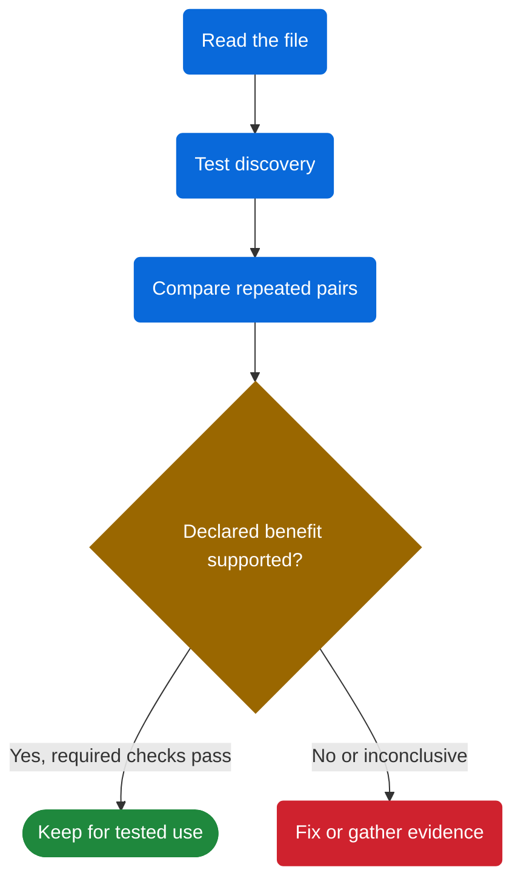

# Measuring skill quality

A finished `SKILL.md` is not a measured skill. Keep one for a tested use when three checks support it:

1. The file is valid and its procedure has a clear boundary.
2. The agent loads it on intended tasks and leaves it closed on near misses, against declared targets.
3. Repeated paired runs support the declared benefit: better results at an accepted cost, or the same required quality with less time or fewer tokens.

Copy [the blank record](../templates/skill-quality-check.md) into the product repo after the [skill trigger](repo-config-checklist.md#optional) fires. Fill it from checks you ran. This repository contains no installed skill and no measured skill result. A blank cell is not a pass.

Published results explain why the comparison matters. [SkillsBench](https://arxiv.org/abs/2602.12670) reports an average task pass rate of 33.9% without curated skills and 50.5% with them across 87 tasks and 18 model-harness setups. [SWE-Skills-Bench](https://arxiv.org/abs/2603.15401) finds no statistically detectable effect for 92 of 98 public software skills; its average share of executable checks passed moves from 76.59% to 76.93%. These are different units, task sets, and invocation methods. Neither average grades your skill. The [README chart](../README.md#published-skill-benchmarks) shows published evidence, not experiments run by this repository.

## 1. Read the file

Separate the [specification's format rules](https://agentskills.io/specification) from authoring recommendations and this repo's quality checks.

| Check | Record |
| --- | --- |
| Required format | YAML frontmatter and Markdown body. `name` is 1–64 lowercase alphanumeric characters or hyphens, matches its folder, and has no leading, trailing, or doubled hyphen. `description` is non-empty and at most 1024 characters. |
| Description and procedure | The description names the work and when to use it. The body can deliver what it promises. A vague description may fit the format and still fail this quality check. |
| Executable steps | Commands, paths, and tools exist for the intended environment. Verification uses the product repo's documented command; if missing, identify it rather than inventing a successful check. |
| Boundary | State when to stop or use a lighter path. Refer to applicable `AGENTS.md` rules instead of copying them. Do not turn a new-task request into unauthorized changes to existing work. |
| Size recommendation | The spec recommends a body under 500 lines and references for detail. A longer body is not automatically invalid; record why its context cost is justified. |

If available, `skills-ref validate ./my-skill` checks naming and frontmatter. This repo does not install it. Record the command or manual inspection used; neither proves discovery or usefulness.

## 2. Test discovery

The agent normally sees a skill's name and description before activation, then loads the body and needed resources. A boundary hidden only in the body cannot help that initial choice. Explicit invocation bypasses discovery; it can still test execution quality. Label the route.

Follow the [description guide](https://agentskills.io/skill-creation/optimizing-descriptions) with realistic, pre-labeled prompts. About 20 is a starting point, roughly balanced between intended loads and near misses. Vary phrasing and detail. A new-demo-app skill should load for a request to create a new demo, and stay closed for an edit to an existing demo. An unrelated weather query tests little about that boundary.

Use roughly 60% for editing and 40% for revision selection. Both contain positive and negative prompts. The selection set is validation, not an untouched test. After choosing a revision, test 5–10 fresh prompts not used for either purpose. Record the split and keep those results separate.

Declare the runs per prompt, per-prompt threshold, positive and negative aggregate targets, and negative observation window before testing. Three fresh sessions per prompt is a practical start: an intended load passes at two or three activations; a near miss passes at zero or one. This follows the guide's 0.5 default, not a universal performance standard.

Record activation evidence: a file read, native invocation, or confirming log. No file read yet is not a completed negative. Observe the full task or a fixed declared decision window. Record incomplete runs separately and explain exclusions; a guess stays unmeasured. Report loaded/valid-run counts and pass counts separately for each split and label.

## 3. Compare output and cost

The [output evaluation guide](https://agentskills.io/skill-creation/evaluating-skills) starts with 2–3 realistic tasks and exploratory paired runs. Use exploration to discover missing checks. Before scoring, freeze the prompts, inputs, success criteria, required checks, benefit claim, cost limits, and repetition plan. If those change, start a new comparison.

Run each task with the skill available and without it. Both conditions use the same repository/input snapshot, model and harness versions, settings, tools, permissions, and budget. Reset output files and verification changes between runs; a fresh chat does not reset the repository. Record whether the available skill actually activated. Do not discard non-activations from an availability comparison. A separately labeled explicit-invocation comparison can isolate execution more directly.

For a revision, compare with the old file as well when useful. Beating a previous version does not establish a benefit over no skill. Record exactly which baseline supports the claim.

Begin with three pairs per task, vary condition order, and retain every run. This is an initial check, not a claim of statistical significance. Small or inconsistent differences need more evidence. Keep task-specific answers and verifier details out of the reusable skill.

Grade frozen checks on both sides and save commands, logs, diffs, outputs, and needed human review. Keep every check:

- Both pass: no gain on that check; retain it to detect later regressions.
- Only the skill passes: a gain.
- Only no-skill passes: a regression, not a row to remove.
- Both fail: inspect the setup and assertion; fix a check only if it was wrong. A real requirement remains failed.

Do not let an easy extra pass compensate for a broken required check. Record duration and tokens using the same definitions on both sides. Missing cost data permits no claim about that cost. Equal required quality with lower measured cost can justify a skill. A faster run that breaks a requirement cannot.

Freezing scored checks and retaining the full regression record are this repo's additional rules; the guide also describes an exploratory iteration loop. Do not treat exploratory results as the final comparison.

## Decide from the record

Use the [template](../templates/skill-quality-check.md) to preserve metadata, targets, prompt splits, individual pairs, evidence, and the decision. Scope the result to the tested tasks, skill version, and agent setup.

| Result | Meaning |
| --- | --- |
| Pass | File checks pass, fresh discovery tests meet declared targets, and repeated output runs support the declared benefit without breaking required checks or cost limits. Keep for that tested use. |
| Fail | A completed required check fails or a predeclared failure threshold is met. Fix the cause before keeping the skill. |
| Inconclusive | Completed measurements establish neither the benefit nor a declared failure. Gather evidence, revise, or leave the skill out. |
| Unmeasured | Required checks or runs have not been completed or recorded. Do not imply they passed. |

Record failures even if other evidence is missing. A blank result is unmeasured, never a silent pass. Remove the layer when its trigger stops being true; do not add more prose to hide an unsupported result. This procedure does not rank models or transfer a published average to an individual skill.

## Main references

Checked on 2026-11-26. Supporting guides are linked at the steps they inform.

1. [SkillsBench](https://arxiv.org/abs/2602.12670) — paired task pass rates with curated skills.
2. [SWE-Skills-Bench](https://arxiv.org/abs/2603.15401) — skill-level effects and executable-check pass ratios.
3. [Agent Skills specification](https://agentskills.io/specification) — format, progressive loading, and recommended structure.
