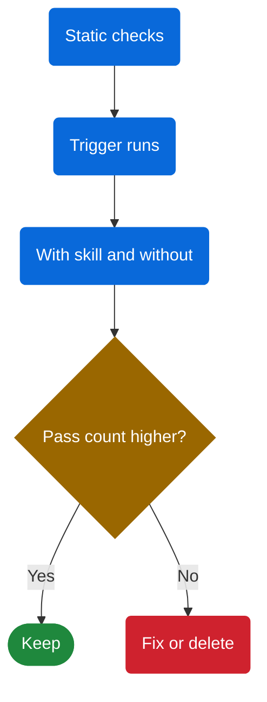

# Measuring skill quality

A skill is a procedure the agent loads when a task matches its description. A finished-looking file is not evidence that this happens. Quality, in this repo, is three recorded facts:

1. The file meets the Agent Skills spec.
2. The agent loads it on the tasks it is for, and leaves it closed on near misses.
3. A fresh run with the skill passes checks that a fresh run without it fails.

Count a fact only from a check you ran. Leave the cell blank otherwise. A blank cell is not a pass. This repo has no skill, so it has no filled record. Copy [templates/skill-quality-check.md](../templates/skill-quality-check.md) into the product repo when a skill's trigger has fired.

The reason to measure is in the published record, not in the file. [SkillsBench](https://arxiv.org/abs/2602.12670) raised the average pass rate on 87 hard tasks from 33.9% to 50.5%, and 13 of those tasks got worse. [SWE-Skills-Bench](https://arxiv.org/abs/2603.15401) found no detectable effect for 92 of 98 public software skills. The pass rates are charted in the [README](../README.md#published-skill-benchmarks). This repository did not run either study. A skill that contains the answer to one graded task is an answer key, not a measurement. A skill fails in use when the path is too heavy to finish, when it replaces a stronger default, or when it points at a tool the agent cannot debug.

Blue is the work. Amber is the decision. Green keeps the skill. Red sends it back.

## What the agent actually sees

At startup the agent loads each skill's `name` and `description`, on the order of 100 tokens, and not the body. It loads `SKILL.md` after it decides the skill applies. Files under `scripts/`, `references/`, and `assets/` load only when a step points at them. The description is the whole trigger. A "When to use" section in the body is invisible until the file is already open.

Agents often skip a skill for a one-step task they can do with ordinary tools. A miss on "read this PDF" does not, by itself, mean the description is bad. The description matters when the task needs a procedure, a format, or a rule the agent would not already follow.

The spec's frontmatter check (`skills-ref validate ./my-skill`) checks the name and description rules. It does not tell you whether the agent loads the skill, or whether the output changed. This repo does not install that tool.

## 1. Static checks

Read the file. Do not start an agent. Record each row in the template.

| Check | Pass when |
| --- | --- |
| `name` | 1 to 64 characters. Lowercase letters, numbers, and hyphens. It does not start or end with a hyphen, does not contain `--`, and matches the folder name. |
| `description` | 1 to 1024 characters. It says what the skill does and when to use it, and it includes words a user would actually type. "Helps with PDFs" fails. |
| Body agrees with the description | The steps can do the thing the description promises. A description that claims a chart, and a body that never makes one, fails. |
| Steps are executable | The steps name the command, path, or tool. They end by running the verify command from `AGENTS.md`. |
| Stop conditions | The file says when the skill does not apply, and it points at the refusals in `AGENTS.md`. |
| Size | The body stays under 500 lines. Detail lives in a referenced file, one link deep from `SKILL.md`. The body does not paste `AGENTS.md` again. |

SkillEval splits a skill document into format, trigger clarity, agreement between the description and the body, concrete commands, a full workflow, explicit inputs and outputs, and failure handling. The rows above are the ones you can decide by reading. A full input and output contract shows up later, as assertions on a real run. The paper reports that a learned reading of those properties tracked pass-rate uplift on SkillsBench (Pearson r from 0.779 to 0.787) and that revisions aimed at the weak properties raised the mean pass rate by 29.5 percentage points. That probe is not a command in this repo.

## 2. Trigger runs

Write the prompts before you rewrite the description to match them.

Use about 20 prompts: 8 to 10 that should load the skill, and 8 to 10 that should not. The useful negatives are near misses. They share words with the skill and need a different procedure. "What is the weather?" shares nothing and tests nothing. Vary the wording: formal, casual, a typo, a prompt that names the domain, and a prompt that only describes the need.

Hold about 40 percent of the prompts back, with both kinds in the held-out set. Edit the description from the training prompts only. Do not paste distinctive words from a failed prompt into the description. That fits those sentences and misses the next user.

Run each prompt in a fresh session, three times. A pass is: the skill should load and the agent opened `SKILL.md`, or it should not load and the agent never opened it. A should-load prompt passes when it loads on more than half the runs. A should-not prompt passes when it loads on fewer than half. Half is the default in the Agent Skills description guide, not a measured law. Write down how you saw the load (a tool call, a log line, a file read). A guess is a blank cell.

Five revision passes are usually enough. If the training prompts still fail, the prompts may be mislabeled. The description guide asks you to pick the revision with the best held-out pass rate, which may be an earlier draft.

## 3. Output runs

Triggering is not a good result. Start with 2 or 3 realistic task prompts, each with a sentence that says what success looks like. Include a path, a name, or a constraint a user would actually give. "Process this data" tests nothing.

Run each prompt twice, in fresh sessions: once with the skill available, once without it. When you are editing an existing skill, keep the previous file and use that as the baseline instead.

After the first pair of runs, write assertions you can check. "The output file is valid JSON" can pass or fail. "The output is good" cannot. Grade each assertion Pass or Fail and quote the output or the command log. A heading that says "Summary" with one empty sentence fails an assertion that asks for a summary.

Drop an assertion that passes both with and without the skill. The model already does that, so the assertion does not measure the skill. Fix an assertion that fails both ways before you blame the file.

Write down the pass count on each side. If the client reports tokens or duration, write those down too. The skill earns its place when the with-skill pass count is higher on the assertions the no-skill run failed, and you accept the extra tokens and time. The same pass count means you fix the skill and run again, or you delete it. A lower pass count means look for a path that is too heavy, a default the skill replaced, or a tool the agent cannot debug, before you add more prose. The [checklist](repo-config-checklist.md#optional) says the same thing: remove the layer when its trigger stops being true.

OpenAI's skill eval notes use the same shape for one skill: on the order of 10 to 20 prompts, a negative control that is adjacent to the skill, and checks for the outcome, the steps taken, and wasted work. Grow the set from misses you actually see. Do not invent a large suite first.

## What this does not measure

A long file, a large skill directory, or a skill that triggers because you named it in the prompt. Explicit invocation checks that the name still resolves. It does not check that the description is any good. Compare the implicit prompts, the ones that never mention the skill, with the near misses.

This repo does not rank skills, agents, or models, and it does not score a file with an embedding. The SkillsBench numbers above are that paper's result under its own setup (Codex, GPT-5.5, three runs per condition). They are not a score for your skill until you run your checks.

## Sources

Checked on 2026-11-26.

- [Agent Skills spec](https://agentskills.io/specification): name, description, progressive disclosure, 500-line body, `skills-ref validate`
- [Optimizing skill descriptions](https://agentskills.io/skill-creation/optimizing-descriptions): description as the trigger, about 20 queries, three runs, the 0.5 default, the held-out split
- [Evaluating skill output quality](https://agentskills.io/skill-creation/evaluating-skills): with-skill and without-skill runs, assertions, evidence, dropping checks that pass both ways
- [Skill authoring best practices](https://platform.claude.com/docs/en/agents-and-tools/agent-skills/best-practices): description says what and when, body under 500 lines, do not write "I can help"
- [Claude Code skills](https://code.claude.com/docs/en/skills): the description is what Claude uses to decide
- [Codex skills](https://learn.chatgpt.com/docs/build-skills): implicit invocation matches the description
- [Testing agent skills with evals](https://developers.openai.com/blog/eval-skills): 10 to 20 prompts, negative controls, outcome and process checks
- [Cursor skills](https://cursor.com/docs/skills): Cursor shows the agent the available skills, and the agent decides when one is relevant
- [Gemini CLI skills](https://geminicli.com/docs/cli/tutorials/skills-getting-started/): a skill file without `name` and `description` is skipped
- [SkillsBench](https://arxiv.org/abs/2602.12670): paired pass rates on hard tasks, tasks that got worse, and the answer-key warning
- [SWE-Skills-Bench](https://arxiv.org/abs/2603.15401): paired pass rates on public software skills
- [SkillEval](https://arxiv.org/abs/2608.06891): document properties, and the SkillsBench correlation cited above
